  
  
  
  

## GitHub activity

  
  

  

  

  

# Nicoleta Leu

QA Automation Engineer in Suceava, Romania. I test API, web and mobile
products end to end, and I build the tooling around the tests: CI pipelines,
reporting, test data.

  
  
  
  
  
  
  
  
  

**Tools I work with:** Robot Framework, Playwright, TypeScript, Appium, Postman,
Python, SQL (MySQL), GitHub Actions, Jira

## Start here

| Repo | What it is |
|---|---|
| [robot-framework-learning](https://github.com/nicoletaleu/robot-framework-learning) | 30 days of Robot Framework: 189 tests, a stub server and a local site, so none of it touches the network |
| [playwright-typescript-tests](https://github.com/nicoletaleu/playwright-typescript-tests) | Three of those Robot web suites ported to Playwright + TypeScript, with what changed between the two tools |
| [qa-portfolio](https://github.com/nicoletaleu/qa-portfolio) | The learning plan, AI as a QA tool, and a Postman collection run by newman in CI |
